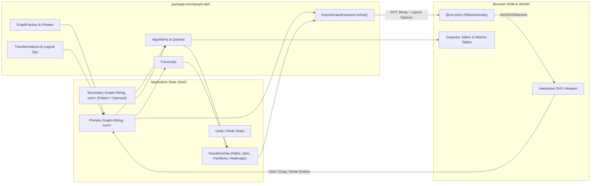

# Graph Web Application Design (`web/graph/`)

## 1. Overview & Objectives

An interactive browser-based graph laboratory for `package:more/graph.dart` hosted in `web/graph/`. The application enables users to construct, import, export, edit, transform, query, traverse, and execute all graph algorithms in `more`, rendering structural and algorithmic results via Graphviz WebAssembly (`@viz-js/viz`) and `ExportGraphExtension.toDot`.

### Core Capabilities

- **Create**: Generate graphs from all `GraphFactory` builders (`complete`, `path`, `ring`, `star`, `completeTree`, `perfectTree`, `partite`, `randomErdosRenyi`, and the 1,253-graph `atlas`), or load curated domain presets.
- **Import & Export**: Load/save graphs via JSON, DSL (path/edge lists, adjacency maps), Graphviz DOT (`toDot`), standalone SVG, PNG, shareable URL state, and executable Dart code snippets.
- **Edit & Manipulate**: Add, rename, or delete vertices and weighted edges either from the inspector or directly on the rendered SVG canvas; apply graph transformations (`reversed`, `complement`, `transitiveClosure`, `transitiveReduction`, `kCore`, `where`, `union`, `intersection`).
- **Visualize**: Render graphs to interactive SVG using `Graph.toDot` and `@viz-js/viz` with switchable Graphviz layout engines (`dot`, `neato`, `fdp`, `sfdp`, `twopi`, `circo`, `osage`), pan/zoom navigation, cluster subgraphs, and heatmaps.
- **Query**: Inspect real-time global invariants (density, transitivity, assortativity, planarity, bipartiteness, Eulerian/Hamiltonian feasibility, diameter, radius, connectivity) and per-vertex/per-edge metrics.
- **Traverse & Run Algorithms**: Execute traversals and algorithms with parameter controls, tabular metric outputs, step-by-step playback animations, and visual graph overlays.

---

## 2. Architecture & Technology Stack

The web app follows the lightweight architecture established in `web/rtree/`:

- **Runtime & DOM**: `package:web` and `dart:js_interop` (compiled via `build_runner` and `build_web_compilers`). Zero external Dart runtime dependencies beyond `package:more` and `package:web`.
- **Visualization Engine**: `@viz-js/viz` v3 (`viz-standalone.min.js` loaded via CDN) invoked through static `dart:js_interop` bindings.
- **DOT Generation**: `ExportGraphExtension.toDot` (`lib/src/graph/operations/export.dart`) translates the in-memory `Graph` and active algorithm overlays into Graphviz DOT syntax.
- **Styling**: Milligram CSS base (matching `web/index.html` and `web/rtree/rtree.html`) augmented with a responsive CSS Grid workspace layout (`web/graph/graph.css`).



---

## 3. Data Model & State Management

### 3.1 Graph Representation

To support both named labels and weighted/capacitated algorithms without runtime type friction, the workspace models graphs as `Graph<String, num>`:

- **Vertices (`String`)**: User-facing identifiers (e.g., `'0'`, `'A'`, `'Zurich'`). `StorageStrategy<String>.defaultStrategy()` is used.
- **Edge Values (`num`)**: Edge weight/cost/capacity (defaults to `1` when unweighted). An `isWeighted` UI toggle controls whether edge values are rendered as edge labels and passed to weighted algorithms, or treated as uniform weight `1`.
- **Directedness (`bool`)**: Toggling directedness reconstructs the active `Graph<String, num>(isDirected: ...)` preserving all vertices and edges.

### 3.2 Workspace State (`AppState`)

```dart
final class AppState {
  /// Primary graph being edited, queried, and visualized.
  Graph<String, num> primaryGraph;

  /// Optional secondary graph for binary operations (union, intersection)
  /// and pattern matching (isomorphism, subgraph isomorphism).
  Graph<String, num>? secondaryGraph;

  /// Whether edge weights are displayed and used as costs/capacities.
  bool isWeighted = true;

  /// Selected Graphviz layout engine ('dot', 'neato', 'fdp', 'sfdp', 'twopi', 'circo').
  String layoutEngine = 'dot';

  /// Selected DOT rank direction ('LR', 'TB', 'RL', 'BT').
  String rankDir = 'LR';

  /// Interactive selection state on the canvas.
  String? selectedSource;
  String? selectedTarget;
  Set<String> selectedVertices = {};
  Edge<String, num>? selectedEdge;

  /// Active algorithm or traversal result overlay.
  VisualOverlay? activeOverlay;

  /// Undo and redo snapshots of (primaryGraph, isWeighted).
  final List<GraphSnapshot> undoStack = [];
  final List<GraphSnapshot> redoStack = [];
}
```

### 3.3 Visual Overlay Model (`VisualOverlay`)

Every traversal, query, or algorithm produces a structured `VisualOverlay` that drives both the `toDot` styling callbacks and the results panel:

```dart
sealed class VisualOverlay {
  const VisualOverlay({required this.title, this.summary = const {}});
  final String title;
  final Map<String, String> summary;
}

/// Highlights an ordered sequence of vertices and/or edges (e.g. shortestPath,
/// findEulerianPath, findHamiltonianPath, BFS/DFS/Topological/RandomWalk).
final class PathOverlay extends VisualOverlay {
  const PathOverlay({
    required super.title,
    required this.vertices,
    required this.edges,
    this.stepNumbers = true,
    super.summary,
  });
  final List<String> vertices;
  final List<(String, String)> edges;
  final bool stepNumbers;
}

/// Highlights subsets of vertices and edges (e.g. articulationPoints, bridges,
/// minimumVertexCover, maximumIndependentSet, kCore, spanningTree, matchings,
/// center/periphery, minCut edges, maxFlow augmenting network).
final class HighlightOverlay extends VisualOverlay {
  const HighlightOverlay({
    required super.title,
    this.highlightedVertices = const {},
    this.secondaryVertices = const {},
    this.highlightedEdges = const {},
    this.edgeLabels = const {},
    super.summary,
  });
  final Set<String> highlightedVertices;
  final Set<String> secondaryVertices;
  final Set<(String, String)> highlightedEdges;
  final Map<(String, String), String> edgeLabels;
}

/// Colors vertices by discrete partition or group ID, optionally grouping
/// them into Graphviz `cluster_*` subgraphs (e.g. vertexColoring,
/// stronglyConnected, connected, biconnectedComponents, louvainCommunities,
/// labelPropagationCommunities, bronKerboschCliques, minCut partitions).
final class PartitionOverlay extends VisualOverlay {
  const PartitionOverlay({
    required super.title,
    required this.vertexGroup,
    this.renderClusters = false,
    this.highlightedEdges = const {},
    super.summary,
  });
  final Map<String, int> vertexGroup;
  final bool renderClusters;
  final Set<(String, String)> highlightedEdges;
}

/// Colors and scales vertices along a continuous numeric range [min, max]
/// (e.g. pageRank, betweennessCentrality, closenessCentrality,
/// eigenvectorCentrality, degreeCentrality, localClusteringCoefficient,
/// coreNumbers, eccentricity).
final class HeatmapOverlay extends VisualOverlay {
  const HeatmapOverlay({
    required super.title,
    required this.scores,
    super.summary,
  });
  final Map<String, num> scores;
}
```

---

## 4. Visualization & Rendering Pipeline

### 4.1 `@viz-js/viz` JS Interop Bindings (`web/graph/viz_interop.dart`)

```dart
import 'dart:js_interop';
import 'package:web/web.dart';

@JS('Viz')
extension type VizNamespace._(JSObject _) implements JSObject {
  external static JSPromise<VizInstance> instance();
}

extension type VizInstance._(JSObject _) implements JSObject {
  external SVGSVGElement renderSVGElement(
    String src, [
    VizRenderOptions? options,
  ]);
  external String renderString(String src, [VizRenderOptions? options]);
}

extension type VizRenderOptions._(JSObject _) implements JSObject {
  external factory VizRenderOptions({String? engine, String? format});
}
```

### 4.2 DOT Generation & Visual Encoding (`Graph.toDot`)

The renderer invokes `primaryGraph.toDot<int>(...)` and injects Graphviz attributes based on the current selection and `activeOverlay`:

- **`graphAttributes`**:
  - `layout`: `state.layoutEngine` (`dot`, `neato`, `fdp`, `sfdp`, `twopi`, `circo`, `osage`).
  - `rankdir`: `state.rankDir` (`LR`, `TB`, `RL`, `BT` — active when `layout == 'dot'`).
  - `bgcolor`: `'transparent'`, `pad`: `'0.3'`, `nodesep`: `'0.4'`, `ranksep`: `'0.6'`.
  - `fontname`: `'Inter, system-ui, sans-serif'`.
- **`vertexAttributes(vertex)`**:
  - `id`: `'v_$vertex'` (enables deterministic DOM lookup on the rendered SVG `<g class="node" id="v_...">`).
  - `shape`: `'circle'` (or `'box'` / `'Mrecord'` when displaying multi-line metric badges).
  - `style`: `'filled'`.
  - **Selection Ring**: `selectedSource` gets a bold green border (`color="#16a34a"`, `penwidth="3"`); `selectedTarget` gets a bold red-orange border (`color="#dc2626"`, `penwidth="3"`).
  - **Overlay Styling**:
    - `PathOverlay`: Visited vertices receive `#dbeafe` fill with step badge `(1)`, `(2)`, ... in `vertexLabel`. Current active playback step receives `#2563eb` fill with white text.
    - `HighlightOverlay`: Primary set receives `#fef08a` fill / `#ca8a04` border; secondary set receives `#e0e7ff` fill / `#4f46e5` border; non-highlighted vertices dim to `#f8fafc` (`fontcolor="#94a3b8"`).
    - `PartitionOverlay`: Maps `vertexGroup[vertex]` to a categorical 12-color Okabe-Ito / Brewer qualitative palette.
    - `HeatmapOverlay`: Normalizes `scores[vertex]` to $t \in [0, 1]$, interpolating fill color along a Viridis/YlOrRd ramp and appending `\n(0.421)` to `vertexLabel`.
- **`edgeAttributes(edge)`**:
  - `id`: `'e_${edge.source}_${edge.target}'`.
  - `label`: Custom overlay label (e.g., `'flow / cap'` for `DinicMaxFlow` or step index `'#1'` for `PathOverlay`), or `isWeighted ? edge.value.toString() : ''`.
  - `color` & `penwidth`: Highlighted edges render with `color="#2563eb"`, `penwidth="2.5"`; non-highlighted edges during an active overlay dim to `color="#cbd5e1"`.
- **`subgraph`, `subgraphName`, `subgraphLabel`, `subgraphAttributes`**:
  - When `activeOverlay` is a `PartitionOverlay(renderClusters: true)`, `subgraph: (v) => overlay.vertexGroup[v]`, `subgraphName: (g) => 'cluster_$g'`, `subgraphLabel: (g) => 'Component ${g + 1}'`, `subgraphAttributes: (g) => {'style': 'rounded,dashed', 'color': '#64748b'}`.

### 4.3 Interactive SVG Canvas Binding

Once `viz.renderSVGElement(dotString)` produces the `SVGSVGElement`:

1. **Pan & Zoom Controller**: Wraps the inner `<g id="graph0">` transform matrix to support mouse-wheel zoom (centered on cursor), click-and-drag panning on the background, and toolbar actions (**Fit to Screen**, **Zoom In**, **Zoom Out**, **100%**).
2. **DOM Event Delegation**:
   - **Click `<g class="node">`**: Selects the vertex. In **Select Mode**, sets `selectedSource` (click) or `selectedTarget` (Shift+click / Alt+click) and displays its properties in the Inspector. In **Add Edge Mode**, clicking vertex `u` then vertex `v` creates edge `(u, v)`. In **Delete Mode**, calls `removeVertex(v)`.
   - **Click `<g class="edge">`**: Selects `Edge(u, v)`, opening an inline weight editor and delete button.
   - **Double-click SVG background**: Prompts/auto-creates a new isolated vertex at the next available label (`'0'`, `'1'`, ... or `'A'`, `'B'`, ...).

---

## 5. Feature Specifications

### 5.1 Create: Generators, Atlas & Presets

Exposes all factory methods from `lib/src/graph/factory/` plus curated examples:

| Category | Generator / Factory API | Configurable Parameters |
| :--- | :--- | :--- |
| **Basic Topologies** | `empty()`, `complete()`, `path()`, `ring()`, `star()` | `vertexCount` ($0 \dots 50$), `isDirected`, weight strategy (uniform `1`, random $1 \dots 20$, Euclidean) |
| **Trees** | `completeTree()`, `perfectTree()` | `vertexCount` or `height` ($0 \dots 6$), `arity` ($1 \dots 5$) |
| **Partite** | `partite()` | Comma-separated layer sizes `vertexCounts` (e.g., `3, 3` for $K_{3,3}$, `2, 3, 2`) |
| **Random** | `randomErdosRenyi()` | `vertexCount` ($1 \dots 60$), `probability` ($0.0 \dots 1.0$), random `seed` |
| **Atlas of Graphs** | `atlas(number)` & `atlasMatching(vertexCount, edgeCount)` | Atlas number ($0 \dots 1252$), filter sliders for `vertexCount` ($0 \dots 7$) and `edgeCount` ($0 \dots 21$), prev/next gallery stepper |
| **Curated Presets** | Built-in domain graphs | • **Petersen Graph** (3-regular, non-planar, non-Hamiltonian)<br>• **Zachary's Karate Club** (community detection benchmark)<br>• **Flow Network** (directed capacitated graph for Dinic max-flow)<br>• **Weighted Road Network** (shortest path / A* / MST demo)<br>• **Negative Edge Graph** (Bellman-Ford / Floyd-Warshall demo)<br>• **Compiler Task DAG** (topological sort, transitive reduction/closure)<br>• **Biconnected Bridges Graph** (articulation points, bridges, blocks) |

### 5.2 Import & Export

#### Import Formats
1. **DSL / Path & Adjacency Text**:
   - **Path / Edge List Mode**: Lines of `u -> v : weight` or chains `A -> B -> C` parsed via `GraphFactory.fromPaths` and `addEdge`.
   - **Successors / Predecessors Map Mode**: Lines of `u: v1, v2, v3` parsed via `GraphFactory.fromSuccessors` or `GraphFactory.fromPredecessors`.
2. **JSON**: Structured schema `{ "isDirected": bool, "isWeighted": bool, "vertices": [...], "edges": [{"source": "A", "target": "B", "value": 5}] }`.
3. **URL Hash State**: Base64URL-encoded compact JSON in `window.location.hash` (`#g=...`) allowing one-click **Copy Shareable Link**.

#### Export Formats
1. **Graphviz DOT (`.dot`)**: Live read-only/copyable code drawer showing `primaryGraph.toDot(...)` with a toggle between *Raw Structural DOT* and *Styled Overlay DOT*.
2. **SVG (`.svg`)**: Serializes the rendered `SVGSVGElement` via `Blob` download.
3. **PNG (`.png`)**: Renders the `SVGSVGElement` data URL onto an offscreen `HTMLCanvasElement` scaled by `window.devicePixelRatio` and triggers a PNG download.
4. **JSON (`.json`)**: Downloads or copies the canonical JSON representation.
5. **Executable Dart Code (`.dart`)**: Generates a self-contained Dart snippet using `package:more/graph.dart` that reproduces the current graph and active algorithm invocation.

### 5.3 Edit, Manipulate & Transform

#### Direct Graph Editing
- **Vertices**: Add vertex (single or batch), rename vertex (via `MapGraphExtension.map`), remove vertex (`removeVertex`).
- **Edges**: Add/update edge (`addEdge(u, v, value: w)`), remove edge (`removeEdge(u, v)`), invert single directed edge, randomize all edge weights (`map(edge: ...)`).
- **Undo / Redo**: Full snapshot history (`Ctrl+Z` / `Ctrl+Shift+Z`) before every mutation or transformation.

#### Structural Transformations (`lib/src/graph/model/` & `lib/src/graph/operations/`)
Each operation can either be **Previewed as Overlay** or **Applied to Primary Graph**:
- **Reverse Edges** (`graph.reversed.copy()`): Reverses all edge directions (directed graphs).
- **Complement Graph** (`graph.complement(allowSelfLoops: false)`): Connects non-adjacent vertex pairs.
- **Transitive Closure** (`graph.transitiveClosure()`): Adds direct edges for all reachable pairs (directed graphs).
- **Transitive Reduction** (`graph.transitiveReduction()`): Removes redundant edges in a DAG while preserving reachability.
- **Extract $k$-Core** (`graph.kCore(k)`): Replaces the graph with its maximal subgraph of minimum degree $\ge k$ (undirected graphs).
- **Extract Spanning Tree** (`graph.spanningTree(...)`): Replaces the graph with its minimum/maximum spanning forest.
- **Filter Subgraph (`graph.where(...)`)**: Interactive filter modal by degree range (`degreeOf(v) >= min`), vertex name regex, edge weight range (`edge.value >= min`), or *Keep Only Highlighted Overlay Vertices*.
- **Binary Operations with Secondary Graph (`B`)**:
  - **Swap Primary $\leftrightarrow$ Secondary** or **Copy Primary $\to$ Secondary**.
  - **Union** (`primary.union(secondary, edgeMerge: ...)` with merge strategy: *keep primary*, *keep secondary*, *sum*, *min*, *max*).
  - **Intersection** (`primary.intersection(secondary, edgeMerge: ...)`).

### 5.4 Query & Structural Inspector

A collapsible **Graph Properties & Invariants** card computes and displays metrics on demand or automatically (for $|V| \le 100$):

#### Global Invariants Table
- **Counts**: $|V|$ (`vertices.length`), $|E|$ (`edges.unique().length`), Connected Components (`connected().length`), Strongly Connected Components (`stronglyConnected().length` if directed).
- **Density & Clustering**:
  - `density()`
  - `transitivity()` (Global clustering coefficient)
  - `averageClusteringCoefficient()`
  - `degreeAssortativity()`
- **Distance & Metric Space** (via `allShortestPaths()`):
  - `diameter`, `radius`, `averagePathLength`
  - `center` (click to highlight center vertices), `periphery` (click to highlight periphery vertices)
- **Connectivity**:
  - `vertexConnectivity()` (global or between `selectedSource` and `selectedTarget`)
  - `edgeConnectivity()` (global or between `selectedSource` and `selectedTarget`)
- **Boolean Classifications** (with instant **Show Witness** button where applicable):
  - `isBipartite()` (click to show 2-coloring partition)
  - `hasCycle()` (directed only)
  - `isPlanar()` (undirected only; Left-Right planarity test)
  - `hasEulerianPath()` / `hasEulerianCircuit()` (click to highlight tour via `findEulerianPath`)
  - `hasHamiltonianPath()` / `hasHamiltonianCircuit()` (click to highlight tour via `findHamiltonianPath`, guarded with a confirmation button if $|V| > 20$)

#### Selected Vertex Inspector (`v`)
When a vertex `v` is clicked, displays:
- `degreeOf(v)`, `inDegreeOf(v)`, `outDegreeOf(v)`
- `localClusteringCoefficient(v)`
- `eccentricity(v)` and `closenessCentrality(v)`
- Interactive pills for `neighboursOf(v)`, `predecessorsOf(v)`, `successorsOf(v)`, `incomingEdgesOf(v)`, `outgoingEdgesOf(v)` (clicking any pill centers/selects that neighbour or edge).

### 5.5 Traversals & Step-by-Step Playback

Covers all iterables in `lib/src/graph/traverse/`:

| Traversal | Extension / Class | Parameters |
| :--- | :--- | :--- |
| **Breadth-First (BFS)** | `breadthFirst(start)` / `breadthFirstAll(seeds)` | Start vertex(es) |
| **Depth-First Pre-Order (DFS)** | `depthFirst(start)` / `depthFirstAll(seeds)` | Start vertex(es) |
| **Depth-First Post-Order** | `depthFirstPostOrder(start)` / `depthFirstPostOrderAll(seeds)` | Start vertex(es) |
| **Topological Sort** | `topological(start)` / `topologicalAll(seeds)` | Start vertex(es) ( default: all vertices) |
| **Random Walk** | `randomWalk(start, ...)` | Start vertex, `selfAvoiding` (`bool`), `useEdgeWeightsAsProbability` (`bool`), `maxSteps` ($1 \dots 200$), `seed` |

#### Playback Controller
Running any traversal (or path-producing algorithm) populates the **Playback Bar** below the canvas:
- Controls: `|<< First`, `< Prev`, `Play / Pause`, `Next >`, `Last >>`, and `Speed (0.5x – 4x)`.
- At step $k$, vertices $v_1 \dots v_{k-1}$ are styled as *visited*, $v_k$ is pulsed as *active*, and tree/discovery edges leading to visited vertices are highlighted with order badges.

### 5.6 Algorithms Catalog & Execution Engine

All algorithms in `lib/src/graph/algorithms.dart` are organized into 9 categories in the right-hand **Algorithms Panel**. Selecting an algorithm reveals its parameter form, precondition badge (e.g., *Requires Undirected Graph*, *Requires Positive Weights*), a **Run** button, and an **Explain / Dart Snippet** toggle.

#### 1. Shortest Paths & Search
- **`shortestPath` / `shortestPathAll` (Dijkstra, Bellman-Ford, A\*)**:
  - *Parameters*: `source` (defaults to `selectedSource`), `target` (optional; if omitted runs `shortestPathAll` from `source`), `algorithmMode` (*Dijkstra*, *Bellman-Ford (`hasNegativeEdges: true`)*, *A\* Heuristic*), `includeAlternativePaths` (`bool`).
  - *Visual Output*: `PathOverlay` highlighting shortest path(s), edge costs, and total `path.cost`. When `target` is omitted, highlights the shortest-path tree from `source` and lists all reachable `Path<String, num>` entries in the results table (clicking any row highlights that specific path).
- **`allShortestPaths` (Floyd-Warshall)**:
  - *Visual Output*: Opens the bottom **Distance Matrix Drawer** displaying the $|V| \times |V|$ distance table (`fw.distance(u, v)`), alongside `diameter`, `radius`, `averagePathLength`, `center`, and `periphery`. Hovering or clicking any cell `(u, v)` in the matrix highlights `fw.path(u, v)` on the SVG graph.

#### 2. Flow, Cuts & Connectivity
- **`maxFlow` (Dinic's Algorithm)**:
  - *Parameters*: `source` (`selectedSource`), `target` (`selectedTarget`).
  - *Visual Output*: Computes maximum flow value `flow = maxFlow()(source, target)` and highlights active flow paths between `source` and `target`.
- **`minCut` (Stoer-Wagner Minimum Cut)**:
  - *Precondition*: Undirected graph, $|V| \ge 2$, positive edge weights.
  - *Visual Output*: `PartitionOverlay` coloring the two cut sides (`minCut.graphs[0]` vs `minCut.graphs[1]`), highlighting the cut edges (`minCut.edges`) in red dashed strokes, and reporting `minCut.weight`.
- **`articulationPoints` & `bridges`**:
  - *Precondition*: Undirected graph.
  - *Visual Output*: `HighlightOverlay` marking cut vertices in crimson and bridge edges in thick dashed red.
- **`biconnectedComponents`**:
  - *Precondition*: Undirected graph.
  - *Visual Output*: `PartitionOverlay` coloring vertices/edges by biconnected block, with a list of component subgraphs in the results drawer.
- **`stronglyConnected` (Tarjan's SCC)** & **`connected`**:
  - *Visual Output*: `PartitionOverlay` with optional `cluster_*` bounding boxes around each component.

#### 3. Spanning Trees
- **`spanningTree` (Kruskal & Prim)**:
  - *Parameters*: `startVertex` (optional; `null` runs Kruskal across all components, non-null runs Prim from `startVertex`), `mode` (*Minimum Spanning Tree* vs *Maximum Spanning Tree* via inverted `weightComparator`).
  - *Visual Output*: `HighlightOverlay` highlighting the tree edges and displaying total tree weight, plus an **Extract as Primary Graph** action button.

#### 4. Centrality & Vertex Scoring
- **Algorithms**:
  - `pageRank(damping: 0.85, tolerance: 1e-6, maxIterations: 100)`
  - `betweennessCentrality(normalized: true)`
  - `closenessCentrality(normalized: true)`
  - `eigenvectorCentrality(maxIterations: 100, tolerance: 1e-6)`
  - `degreeCentrality()`, `inDegreeCentrality()`, `outDegreeCentrality()`
  - `localClusteringCoefficient(v)` (computed across all $v \in V$)
  - `coreNumbers()` (undirected)
- *Visual Output*: `HeatmapOverlay` coloring vertices along a continuous gradient, plus a sortable multi-column **Vertex Metrics Table** where users can compare all centrality measures side by side and click any column header to re-color the graph by that metric.

#### 5. Coloring, Cliques & Vertex Covers
- **`vertexColoring`**:
  - *Visual Output*: `PartitionOverlay` assigning distinct palette colors to each color class and reporting chromatic number $\chi(G)$ used.
- **`findCliques` (Bron-Kerbosch Maximal Cliques)**:
  - *Precondition*: Undirected graph.
  - *Visual Output*: Lists all maximal cliques sorted by size descending (highlighting clique number $\omega(G)$); clicking any clique in the list highlights its induced complete subgraph via `HighlightOverlay`.
- **`minimumVertexCover` & `maximumIndependentSet`**:
  - *Precondition*: Undirected graph.
  - *Parameters*: `approximate` (`bool` — exact branch-and-bound vs 2-approximation / greedy heuristic).
  - *Visual Output*: `HighlightOverlay` marking the cover or independent set vertices and incident covered edges.

#### 6. Matching
- **`bipartiteMatching` & `weightedBipartiteMatching`**:
  - *Precondition*: Undirected bipartite graph.
  - *Parameters*: `weighted` (`bool`), `maximumWeight` (`true` for max-weight, `false` for min-weight maximum-cardinality matching).
- **`maximumMatching` (Edmonds' Blossom Algorithm)**:
  - *Precondition*: Undirected graph (works on general non-bipartite graphs).
- *Visual Output*: `HighlightOverlay` highlighting matched edges `(u, match[u])` in bold green, matched vertices, unmatched (exposed) vertices, cardinality $|M|$, and total matching weight.

#### 7. Community Detection
- **`louvainCommunities`**:
  - *Precondition*: Undirected graph.
  - *Parameters*: `resolution` ($\gamma > 0$, default `1.0`), `renderClusters` (`bool`).
- **`labelPropagationCommunities`**:
  - *Precondition*: Undirected graph.
  - *Parameters*: `maxIterations` (default `100`), `seed` (optional `int`), `renderClusters` (`bool`).
- *Visual Output*: `PartitionOverlay` coloring communities (and drawing Graphviz `cluster_*` boxes if `renderClusters` is checked), computing and displaying the partition's Newman-Girvan **`modularity(communities)`** score $Q$.

#### 8. Eulerian & Hamiltonian Tours
- **`findEulerianPath(circuit: bool)`**:
  - *Visual Output*: `PathOverlay` with numbered edge traversal sequence `1..|E|` and step-by-step playback.
- **`findHamiltonianPath(circuit: bool)`**:
  - *Visual Output*: `PathOverlay` highlighting the cycle/path visiting every vertex `1..|V|` and step-by-step playback.

#### 9. Planarity & Graph Isomorphism
- **`isPlanar`**:
  - *Precondition*: Undirected graph.
  - *Visual Output*: Displays planarity verdict; if planar, suggests switching layout engine to `neato` / `fdp` for planar-style embedding.
- **`isIsomorphicTo` & `findSubgraphIsomorphisms` (VF2)**:
  - *Parameters*: Compares `primaryGraph` (Target $G$) against `secondaryGraph` (Pattern $H$). Includes quick-load buttons to populate $H$ (e.g., *Triangle $K_3$*, *Square $C_4$*, *5-Cycle $C_5$*, *$K_{3,3}$*, *$K_5$*, or *Permuted Copy of Primary*).
  - *Visual Output*: Reports total isomorphism count and provides a match selector (`Match 1 of k`). Selecting a match highlights the matched target vertices and edges in `primaryGraph` and labels each matched vertex `$v \mapsto w$` with its corresponding pattern vertex in `secondaryGraph`.

---

## 6. User Interface Layout

```
+--------------------------------------------------------------------------------------------------+
|  Dart More — Graph Playground    [Directed: ON] [Weighted: ON]    Layout: [dot v] [LR v]         |
|  [Undo] [Redo] [Clear]  |  [Import/Export] [Share Link] [Dart Code] [DOT Source]                 |
+------------------------+------------------------------------------------+------------------------+
| LEFT PANEL (280px)     | CENTER WORKSPACE (Flex 1)                      | RIGHT PANEL (340px)    |
|                        | +--------------------------------------------+ |                        |
| [Create] [Edit] [Ops]  | | Mode: (o) Select  ( ) Add Node  ( ) Edge   | | [Algorithms] [Query]   |
|                        | |       ( ) Delete  | Source: [A] Target: [F]| | [Traversals]           |
| -- Generator --------- | +--------------------------------------------+ |                        |
| Preset / Factory:      | |                                            | | Category:              |
| [Karate Club       v]  | |              [ Interactive ]               | | [Shortest Paths     v] |
| Vertices: [ 12 ]       | |              [   Graphviz  ]               | |                        |
|Directed: [x]           | |              [ SVG Canvas  ]               | | Algorithm:             |
| [Generate Graph]       | |                                            | | [Dijkstra / A*      v] |
|                        | |        (A) ----5----> (B) ----2----> (F)   | |                        |
| -- Atlas Browser ----- | |         |              |              ^    | | Source: [ A v ]        |
| # [ 18 ] (<) (>)       | |         3              1              4    | | Target: [ F v ] (All)  |
| Filter |V|=[4] |E|=[6] | |         v              v              |    | | [ ] Negative Edges     |
|                        | |        (C) ----6----> (D) ------------+    | | [ ] Alternative Paths  |
| -- Quick Edit -------- | |                                            | |                        |
| Vertex: [   ] [+][-]   | |                                [Fit] [+][-]| | [  Run Algorithm  ]    |
| Edge: [u]->[v] w=[1]   | +--------------------------------------------+ | [  Clear Overlay  ]    |
| [Add / Update Edge]    | | PLAYBACK: [|<] [<] [Play] [>] [>|] Step 3/6| |                        |
|                        | +--------------------------------------------+ | -- Results ----------- |
| -- Transformations --- | | BOTTOM DRAWER: [Metrics Table] [Matrix]    | | Cost: 10               |
| [Reverse] [Complement] | |                [DOT Output] [Dart Snippet] | | Path: A -> B -> D -> F |
| [Trans. Closure]       | | Vertex | Deg | PageRank | Betweenness      | |                        |
| [Trans. Reduction]     | | A      | 2   | 0.142    | 0.000            | | 1. A -> F (cost 10)    |
| [k-Core: k=2] [Filter] | | B      | 3   | 0.218    | 0.450            | | 2. A -> D (cost 6)     |
+------------------------+------------------------------------------------+------------------------+
```

---

## 7. File Organization & Implementation Plan

All application files reside under `web/graph/` and integrate with `web/index.html`:

| File Path | Responsibility |
| :--- | :--- |
| `web/index.html` | Add entry link `<li><a href="graph/graph.html">Graph</a></li>` alongside `RTree`. |
| `web/graph/graph.html` | Main application shell, loading Milligram CSS, `graph.css`, `@viz-js/viz` CDN script, and compiled `graph.dart.js`. |
| `web/graph/graph.css` | CSS Grid 3-column studio layout, SVG viewport styles, badge/chip controls, and responsive drawers. |
| `web/graph/graph.dart` | Entry point (`main()`), DOM wiring, keyboard shortcuts, and coordination between state, renderer, and panels. |
| `web/graph/state.dart` | `AppState`, `GraphSnapshot` undo/redo management, URL hash serialization, and `VisualOverlay` classes. |
| `web/graph/viz_interop.dart` | `dart:js_interop` bindings for `@viz-js/viz` (`VizNamespace`, `VizInstance`, `VizRenderOptions`). |
| `web/graph/renderer.dart` | Converts `AppState` + `VisualOverlay` into DOT via `Graph.toDot`, renders SVG via `VizInstance`, attaches SVG node/edge click listeners, and manages viewport pan/zoom. |
| `web/graph/presets.dart` | `GraphFactory` invocations, Atlas browser helpers, and curated domain preset graphs. |
| `web/graph/algorithms_runner.dart` | Descriptors, parameter schemas, execution wrappers, and Dart code-snippet generators for all traversals, queries, and algorithms in `package:more/graph.dart`. |
| `web/graph/io.dart` | Importers and exporters for JSON, path/adjacency DSL, DOT, SVG, PNG, and shareable URLs. |

### Implementation Phases

1. **Phase 1 — Core Shell & Visualization**: Implement `viz_interop.dart`, `state.dart`, `renderer.dart`, and `graph.html` with `Graph.toDot` rendering, pan/zoom SVG viewport, and interactive vertex/edge selection.
2. **Phase 2 — Creation, Editing, Transformations & I/O**: Implement `presets.dart` (all `GraphFactory` generators, Atlas browser, curated presets), interactive canvas editing, undo/redo history, graph transformations (`reversed`, `complement`, `transitiveClosure`, `transitiveReduction`, `kCore`, `where`, `union`, `intersection`), and `io.dart` (JSON, DSL, DOT, SVG, PNG, Dart snippet export).
3. **Phase 3 — Queries, Traversals & Playback**: Implement real-time global/vertex property inspectors and animated step-by-step playback for `breadthFirst`, `depthFirst`, `depthFirstPostOrder`, `topological`, and `randomWalk`.
4. **Phase 4 — Full Algorithms Suite**: Wire all 9 algorithm categories in `algorithms_runner.dart` to `VisualOverlay` (paths, sets, partitions/clusters, heatmaps), the Floyd-Warshall distance matrix drawer, and the sortable vertex centrality table.
